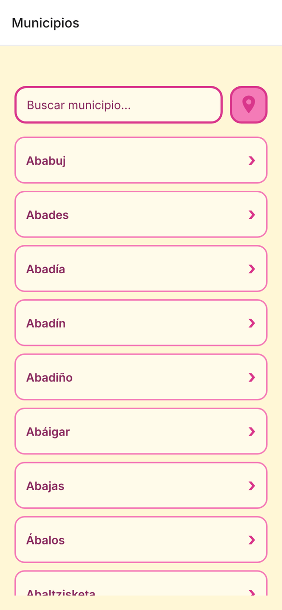
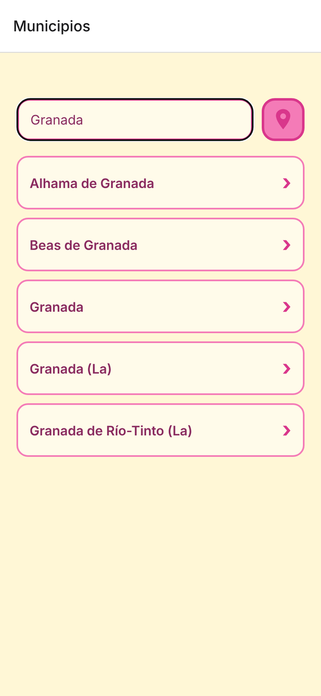
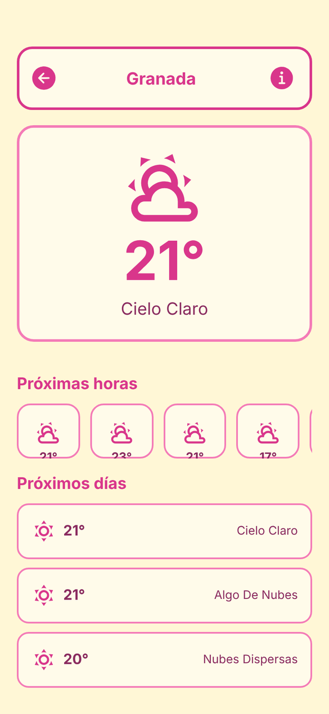
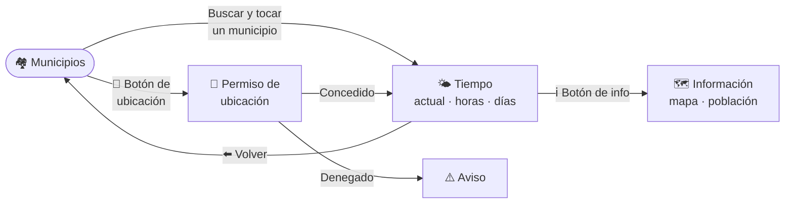
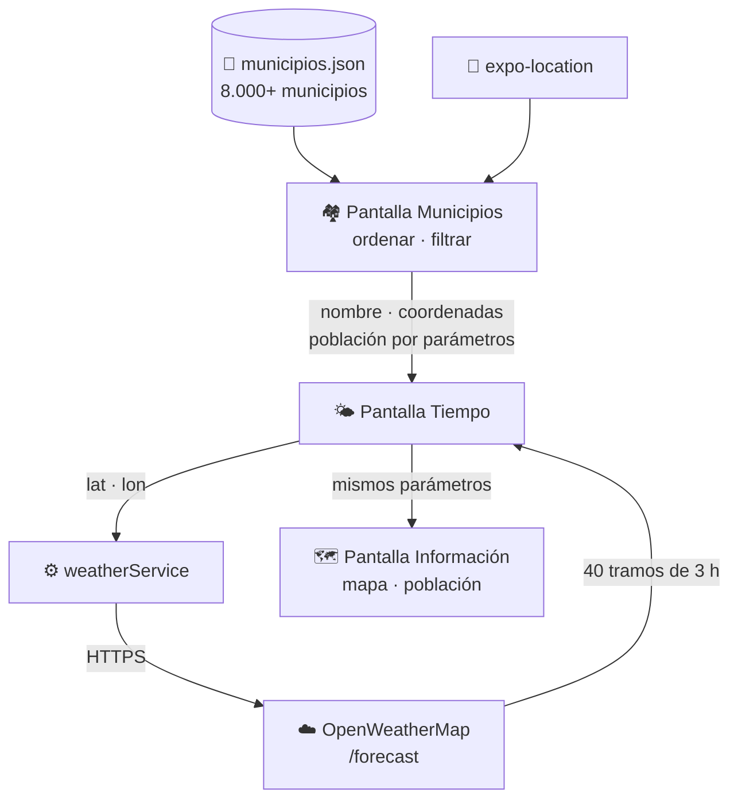

<div align="center">

# 🌤️ AppTiempo

### El tiempo de cualquier pueblo de España, en tu bolsillo

App móvil para consultar la previsión meteorológica de los **más de 8.000 municipios de España** o de tu ubicación actual, con mapa y datos de población de cada municipio.

<br/>


</div>

---

## 📖 Índice

- [Qué hace](#-qué-hace)
- [Funcionalidades](#-funcionalidades)
- [Capturas](#-capturas)
- [Cómo se usa](#-cómo-se-usa)
- [Tecnologías](#️-tecnologías)
- [Cómo funciona por dentro](#-cómo-funciona-por-dentro)
- [Datos](#-datos)
- [Diseño](#-diseño)
- [Estructura del proyecto](#-estructura-del-proyecto)
- [Ejecutar en local](#-ejecutar-en-local)
- [Posibles mejoras](#-posibles-mejoras)

---

## 🎯 Qué hace

Las apps del tiempo suelen centrarse en ciudades grandes. **AppTiempo** incluye todos los municipios de España, desde una capital de provincia hasta el pueblo más pequeño, y además de la previsión muestra **dónde está** cada municipio y **cuánta gente vive** en él.

Es un proyecto del Máster en Desarrollo de Aplicaciones Web para practicar desarrollo móvil con **React Native y Expo**: navegación, consumo de una API externa, permisos del dispositivo (ubicación) y mapas nativos.

---

## ✨ Funcionalidades

|     | Funcionalidad                | Detalle                                                                                    |
| :-: | ---------------------------- | ------------------------------------------------------------------------------------------ |
| 🔍  | **Buscador de municipios**   | Lista de más de 8.000 municipios ordenada alfabéticamente, que se filtra mientras escribes |
| 📍  | **Mi ubicación**             | Con un toque, pide permiso de ubicación y muestra el tiempo donde estás                    |
| 🌡️  | **Tiempo actual**            | Temperatura y descripción del cielo en español                                             |
| 🕐  | **Próximas 24 horas**        | Previsión en tramos de 3 horas, en un carrusel horizontal                                  |
| 📆  | **Próximos días**            | Previsión de los siguientes 5 días                                                         |
| 🗺️  | **Mapa**                     | Mapa nativo con un marcador en el municipio                                                |
| 👥  | **Datos de población**       | Habitantes totales, hombres y mujeres                                                      |
| ⏳  | **Estados de carga y error** | Indicador mientras llegan los datos y mensaje claro si la API falla                        |

---

## 📸 Capturas

<div align="center">

|                        Municipios                        |                        Buscador                        |                      Previsión                       |
| :------------------------------------------------------: | :----------------------------------------------------: | :--------------------------------------------------: |
|  |  |  |

</div>

---

## 🧭 Cómo se usa



1. **Busca** un municipio escribiendo su nombre, o pulsa el **icono de ubicación** para usar dónde estás.
2. **Consulta el tiempo**: ahora, las próximas horas y los próximos días.
3. Pulsa el **icono de información** para ver el municipio en el mapa, su provincia, su comunidad y su población.

---

## 🛠️ Tecnologías

| Herramienta            | Para qué la uso                                                            |
| ---------------------- | -------------------------------------------------------------------------- |
| **React Native**       | Una sola base de código para Android, iOS y web                            |
| **Expo**               | Desarrollo y acceso a funciones nativas del móvil                          |
| **Expo Router**        | Navegación por pestañas basada en archivos y paso de datos entre pantallas |
| **TypeScript**         | Tipado del código                                                          |
| **expo-location**      | Pedir permiso y obtener las coordenadas del usuario                        |
| **react-native-maps**  | Mapa nativo con marcador                                                   |
| **OpenWeatherMap API** | Previsión meteorológica a 5 días en tramos de 3 horas                      |
| **@expo/vector-icons** | Iconos de Ionicons y Material Community                                    |

---

## 🔧 Cómo funciona por dentro



<details>
<summary><b>🔍 Búsqueda instantánea sin servidor</b></summary>

<br/>

Los municipios vienen de un archivo JSON incluido en la app, así que buscar no necesita conexión. La lista se ordena alfabéticamente con `localeCompare` (respetando tildes y la ñ) y se filtra sin distinguir mayúsculas. Se pinta con `FlatList`, que solo renderiza los elementos visibles y mantiene la app fluida con miles de filas.

</details>

<details>
<summary><b>🌍 Coordenadas con coma decimal</b></summary>

<br/>

En el archivo de datos las coordenadas usan **coma** como separador decimal (`37,14114`), al estilo español. Antes de llamar a la API se convierten a **punto** (`37.14114`), que es el formato que entiende OpenWeatherMap y el mapa.

</details>

<details>
<summary><b>🕐 De 40 tramos a horas y días</b></summary>

<br/>

La API devuelve **40 previsiones**, una cada 3 horas durante 5 días. A partir de esa lista:

- **Ahora:** el primer tramo.
- **Próximas 24 horas:** los 8 primeros tramos (8 × 3 h).
- **Próximos días:** uno de cada 8 tramos, es decir, una previsión por día.

La petición se hace en **grados Celsius** y con las descripciones **en español**.

</details>

<details>
<summary><b>🔀 Datos entre pantallas</b></summary>

<br/>

Al tocar un municipio, sus datos (nombre, provincia, comunidad, coordenadas y población) viajan como **parámetros de navegación** de Expo Router. La pantalla de información reutiliza esos mismos parámetros, así que no hace falta volver a buscar el municipio.

</details>

<details>
<summary><b>📍 Permisos de ubicación</b></summary>

<br/>

El botón de ubicación pide permiso **solo cuando el usuario lo pulsa**, no al abrir la app. Si lo deniega, se le avisa y puede seguir usando el buscador con normalidad.

</details>

---

## 📊 Datos

El archivo `data/municipios.json` contiene **8.112 municipios** de las 17 comunidades autónomas, más Ceuta y Melilla. Cada registro incluye:

| Campo                          | Ejemplo              |
| ------------------------------ | -------------------- |
| Comunidad                      | Andalucía            |
| Provincia                      | Almería              |
| Población (nombre)             | Abla                 |
| Latitud · Longitud             | 37,14114 · -2,780104 |
| Altitud                        | 871 m                |
| Habitantes · Hombres · Mujeres | 1.504 · 783 · 721    |

La previsión meteorológica viene de la API **[5 Day / 3 Hour Forecast](https://openweathermap.org/forecast5)** de OpenWeatherMap.

---

## 🎨 Diseño

Estética propia, alegre y cálida, alejada de los azules típicos de las apps del tiempo:

| Color             | Uso                      |
| ----------------- | ------------------------ |
| 🟡 Amarillo crema | Fondo de las pantallas   |
| 🩷 Rosa fuerte    | Bordes, iconos y botones |
| 🌸 Rosa suave     | Detalles                 |
| 🍏 Verde          | Acentos                  |
| 🍷 Granate        | Texto                    |

Las tarjetas tienen bordes gruesos redondeados y los iconos son grandes para que la app sea fácil de usar con una mano.

---

## 📁 Estructura del proyecto

```
AppTiempo/
├── app/
│   ├── _layout.tsx           # Navegación raíz
│   └── (tabs)/
│       ├── _layout.tsx       # Configuración de las pestañas
│       ├── index.tsx         # 🏘️ Buscador de municipios y ubicación
│       ├── weather.tsx       # 🌤️ Previsión: ahora, horas y días
│       └── info.tsx          # 🗺️ Mapa y datos de población
├── services/
│   └── weatherService.ts     # ⚙️ Llamada a la API de OpenWeatherMap
├── data/
│   └── municipios.json       # 📄 Municipios de España
├── components/               # Componentes reutilizables
├── constants/                # Tema y colores
├── hooks/                    # Hooks de tema
└── app.json                  # Configuración de Expo
```

---

## 💻 Ejecutar en local

**Requisitos:** Node.js 20 o superior, npm y la app **Expo Go** en el móvil (o un emulador de Android / simulador de iOS).

```bash
# 1. Clonar el repositorio
git clone https://github.com/angelalop03/AppTiempo.git
cd AppTiempo

# 2. Instalar dependencias
npm install

# 3. Arrancar
npx expo start
```

Escanea el código QR con Expo Go, o pulsa `a` para Android, `i` para iOS o `w` para web.

> 🔑 La app usa una clave de la API de OpenWeatherMap, que se configura en `services/weatherService.ts`. Puedes conseguir una gratis registrándote en [openweathermap.org](https://openweathermap.org/api).

| Comando           | Descripción                               |
| ----------------- | ----------------------------------------- |
| `npm start`       | Arranca el servidor de desarrollo de Expo |
| `npm run android` | Abre la app en Android                    |
| `npm run ios`     | Abre la app en iOS                        |
| `npm run web`     | Abre la versión web                       |
| `npm run lint`    | Analiza el código                         |

---

## 🚀 Posibles mejoras

- [ ] Iconos del tiempo que cambien según el cielo (sol, nubes, lluvia…)
- [ ] Temperaturas máxima y mínima de cada día
- [ ] Guardar municipios favoritos
- [ ] Filtrar por comunidad o provincia
- [ ] Mover la clave de la API a una variable de entorno

---

<div align="center">

### 👩‍💻 Desarrollado por **Ángela López Oliva**

Máster en Desarrollo de Aplicaciones Web · Universidad Europea

[](https://github.com/angelalop03)
[](https://portfolio-v2-rosy-eight.vercel.app/)

⭐ Si te ha gustado, ¡déjale una estrella al repo!

</div>
